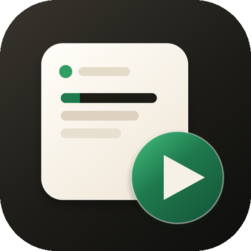

# MollyRun



Run local Python scripts and shell commands from one Mac window. The files stay in your projects. MollyRun keeps a list, starts and stops them, and shows the output.

**[Download 0.1.0 for Apple silicon](https://github.com/mm22hh/MollyRun/releases/download/v0.1.0/MollyRun-0.1.0-mac-arm64.zip)** · [All releases](https://github.com/mm22hh/MollyRun/releases)

Requires macOS on Apple silicon. This build is not code-signed. Unzip it, move `MollyRun.app` into Applications, then Control-click the app and choose Open the first time.

## What it is for

A place for scripts you leave running: a training job, a worker, a short command. Each one gets a terminal, without a pile of separate windows.

Closing a tab hides that terminal. It does not stop the script. If anything is still running when you quit, MollyRun asks before it stops them.

## What you can do

- Register a Python file, using the system Python or a virtual environment, plus arguments such as `--epochs 10`
- Or register one shell command and run it in the terminal
- Start a script, and confirm before stopping it
- Watch output in tabs, or tile two or three terminals
- Show only the scripts that are running
- Reorder, edit, and delete entries
- Use light, dark, or system appearance

A virtual environment uses that environment's Python, and its `bin` directory is placed first on `PATH`.

Python files are not copied. They stay in your projects. The list is stored only on this Mac, at `~/Library/Application Support/MollyRun`.

## Build it yourself

```bash
npm install
npm run dev
```

To produce the app:

```bash
npm run dist
```

The bundle is written to `release/mac-arm64/MollyRun.app`.
